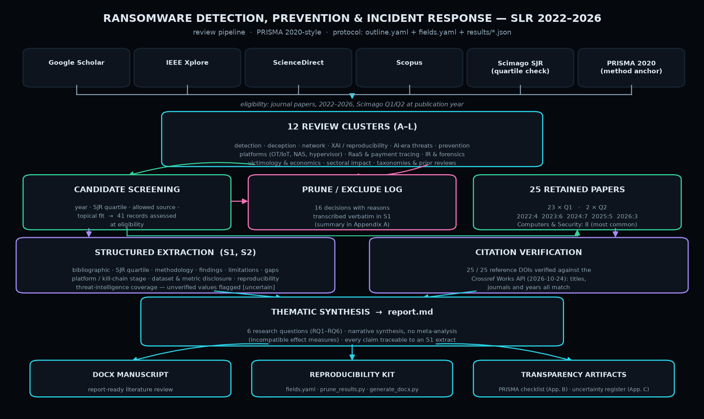

# Ransomware SLR: Detection, Prevention & Incident Response (2022–2026)

A systematic literature review (PRISMA 2020-style) of the peer-reviewed ransomware
defense literature, built with a scripted multi-agent research pipeline. **25 papers
retained** (23 × Q1, 2 × Q2 — Scimago SJR at publication year) across **12 review
clusters**, every reference DOI verified against Crossref.

## Objective

Defenders face a fragmented ransomware evidence base: detection research is dominated
by laboratory ML prototypes with ad-hoc datasets, while causal evidence on
organizational and human impact has only recently appeared. This review identifies,
verifies and synthesizes the 2022–2026 journal literature into one traceable,
reproducibility-first record.

## Scope and Safety

Research/documentation project — no attack tooling, no exploits, no lab attack
traffic. All content is method, extraction and synthesis over public academic
literature. Built for the author's own research portfolio (MCS442 project context).

## Research Questions

1. **RQ1 (Detection):** Which detection families exist in verified Q1/Q2 journals, at
   which kill-chain stage do they act, and what is known about real-world effectiveness?
2. **RQ2 (Adversarial shift):** What does evidence say about offensive AI/LLM
   automation of the ransomware lifecycle?
3. **RQ3 (Prevention & response):** Which designs link prevention, resilience and IR
   to realized outcomes?
4. **RQ4 (Threat-actor economy):** RaaS economics, payment tracing, extortion
   deception, victim-side decision-making?
5. **RQ5 (Impact):** Quantified, causal impact on service delivery (especially healthcare)?
6. **RQ6 (Reproducibility):** How reproducible is the field's evidence, and what
   dataset/benchmark gaps dominate?

## Tools and Stack

| Tool | Role |
|------|------|
| Python 3.11 + PyYAML | extraction/pruning/report pipeline |
| `fields.yaml` | extraction schema (bibliographic, content, PRISMA, stratification, reproducibility, threat-intel) |
| Google Scholar / IEEE Xplore / ScienceDirect / Scopus | literature sources (per protocol) |
| Scimago SJR | quartile verification at publication year |
| Crossref Works API | DOI verification (25/25 confirmed, 2026-10-24) |
| python-docx | DOCX manuscript generation |

## Methodology

1. **Register** — 12 review items (A–L) in `outline.yaml`, one per theme.
2. **Screen** — candidates checked against year (2022–2026), SJR quartile at
   publication year, allowed-source traceability and topical fit → 41 records assessed.
3. **Prune** — 16 exclusions with reasons transcribed verbatim (record-overlap,
   validity, venue, recency) — `prune_results.py` → 25 retained.
4. **Extract** — structured per-paper extraction per `fields.yaml`; every
   unverified value flagged `[uncertain]` rather than filled in.
5. **Verify** — all 25 reference DOIs checked against Crossref
   (`results/citation_verification_crossref_2026-10-24.json`).
6. **Synthesize** — narrative thematic synthesis (no meta-analysis: incompatible
   effect measures) → `report.md` → `generate_docx.py` → DOCX manuscript.

## Findings (one-line version)

- Detection research is reactive and laboratory-bound: host/ML approaches struggle
  with evasion and non-standardized datasets; hardware/SSD and deception designs
  achieve high detection at low overhead; network/federated designs extend coverage.
- XAI can be layered onto detectors, but dataset availability is the field's central
  replication bottleneck.
- Empirical proof exists that LLMs can generate full attack chains (incl. encryption).
- Econometrics and clinical studies now quantify human impact: hospital ransomware
  reduced volume ~17–24% and increased in-hospital mortality ~34–38% among
  already-admitted patients.

## Repository Map

| Path | What it is |
|------|-----------|
| `report.md` | the review (abstract → methodology → results → discussion → references → appendices) |
| `extraction_catalog.md` | Supplementary S1 — full per-study extraction catalog, preserved unchanged |
| `results/*.json` | per-cluster extraction records (A–L) + Crossref verification log |
| `fields.yaml` | extraction schema |
| `outline.yaml` | cluster/registry outline used by the pipeline |
| `generate_report.py` / `generate_docx.py` | rebuild `report.md` / the DOCX from `results/` |
| `prune_results.py` | one-shot prune step (records moved with rationale, never deleted) |
| `docs/make_pipeline_diagram.py` | regenerates `docs/pipeline.png` |

## Transparency and Limitations (declared in the review itself)

- **No query-level search logs** were recorded during the deep-research phase; the
  review reports record-level provenance instead (largest PRISMA-2020 item-7
  deviation, flagged in Appendix B).
- **Single-reviewer screening**, automated pipeline; no RoB 2 / ROBINS-I instrument —
  quality proxies extracted instead.
- **Quartile-only inclusion** under-represents conference/reproducibility-methods
  literature (documented in Appendix A).
- The ICPSR replication-package DOI is not Crossref-registered; retained with the
  limitation stated rather than deleted.

## MITRE ATT&CK Lens

Detection papers stratify by kill-chain stage; review items map to:

| Technique | Name | Covered by clusters |
|-----------|------|--------------------|
| T1486 | Data Encrypted for Impact | A, B, C, D, G |
| T1485 | Data Destruction | B, F |
| T1567 / T1657 | Exfiltration / financial-theft extortion (double extortion) | E, H, J, K |

## Lessons Learned / Next Steps

- Reproducibility must be designed into the pipeline *before* searching: record
  query strings and per-database logs from day one.
- Next: PROSPERO-style OSF pre-registration if the review is extended; full PRISMA
  checklist attach at manuscript submission.

## License

MIT — see [LICENSE](LICENSE).
